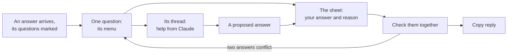

# Answering an AI's questions: design

25 November 2026 · Hideaki Hayashi

> **How to read this.** This is the design as it was proposed on 25 November
> 2026, kept as a record of why the feature has its shape. The text down to
> "Open questions" is not changed when the code changes. What was decided
> after that day is in [Decisions since](#decisions-since), oldest first,
> and an entry there overrides the text above it. How the code works now is
> in [CLAUDE.md](../CLAUDE.md). What the feature does for a reader is in the
> [README](../README.md#answer-what-another-chat-asked-you).

## Summary

When another Claude chat asks the reader several questions at once, the page lets them answer one at a time, with help, and take one coherent reply back.

The problem is that a batch of questions is hard to answer in a single message. Each question needs its own understanding: why it is asked, what the choices mean, what follows from each. The questions also arrive flat, with the pivotal one looking like the trivial ones, and a chat's one message box asks for all the answers together.

The feature builds on the inbox. An answer sent to the page arrives with its questions marked where they stand in the text. Each question opens a small menu, and each can have its own side thread, in which the page's Claude helps the reader reach an answer. The answers collect in one sheet for the conversation. Before the reader copies the reply, one check reads all the answers together and names conflicts.

This document records what was decided in discussion on 25 November 2026 and proposes the rest. The page code was then built on a branch, and the last section says what was decided after that day.

## Scope

The feature handles the questions of an answer that was sent to the page, and nothing else. Each line below was decided on 25 November 2026.

| Point | Decision |
| --- | --- |
| Which answers | Only an answer sent in from another chat. Questions that the page's own Claude asks while helping stay plain chat. |
| Which questions | Only those the answer asks explicitly. A stated assumption is not treated as a question. |
| How many | The handling is there for a single question too, so that "Why do you ask?" is always one click away. |
| Where the questions are | Usually inside the prose, not in a list. The design does not assume a list. |
| What the sender supplies | The questions only. No reason and no options: the helper infers those. |
| Stale answers | No mark on an answer that was settled before another one changed. The final check finds conflicts. |
| The check's input | The answers with their reasons, since a conflict often shows only in the reasons. |
| The check's place | A thread of its own. The tree has no main thread, so nothing may depend on one. |

Out of scope for now: sending the reply back to the original chat without copy and paste, and linking a second round of questions to the first.

## The experience

The reader settles one question at a time, in any order, and the page keeps the answers together until the reply is copied.



A question is settled from its menu or from its side thread, and either way it is the reader who puts the answer on the sheet. The check sends the reader back to a question when two answers conflict.

1. **Arrival.** A chat sends an answer and lists the questions it asks. The page opens it as a new conversation, as it does today.
2. **Marks.** Each question is highlighted where it stands in the text. A marker beside it shows its state: open, answered, or left to the asker.
3. **The sheet.** A folded strip sits at the foot of the pane that shows the sent answer, above its message box. It reads "3 questions, 0 settled" and unfolds to one row per question.
4. **The menu.** Clicking a question, or its row in the sheet, opens a small menu at the question.
5. **The thread.** A help from the menu opens the question's side thread beside the answer. A question has one thread, and a later help continues it, as with a passage today.
6. **A proposal.** Only when it fits, a reply of the helper ends with a proposed answer, a short reason, and a "Use as my answer" button.
7. **Settling.** The answer and its reason go to the sheet. The marker changes. The thread stays as it is, and the reader can go on in it.
8. **The check.** "Check them together" on the sheet opens the check thread, which names answers that conflict and answers that cannot be understood on their own.
9. **The reply.** "Copy reply" puts every question with its answer and reason on the clipboard, for pasting into the original chat. Open questions are listed as not answered yet.

### The menu of one question

| Item | What it does |
| --- | --- |
| A text box, "Type your answer" | Settles the question with the typed words. A second box under it takes a reason, which may be left empty. |
| Why do you ask? | Asks the helper what depends on the answer. |
| What would you pick? | Asks the helper for the choices it sees and the one it would take. |
| Help me answer | The helper asks easier questions about the reader's situation, one at a time, then proposes an answer. |
| Your call | Leaves the decision to the asker. The reply says so. |
| Open the thread | Shown when the question already has one. |

An answered question shows its answer at the top of the menu, with "Change".

### What stays as it is

- Every message box keeps talking to the helper. The sheet does not take one over.
- Any passage of the sent answer can still be asked about in the usual way.
- A reader who ignores the marks and the sheet loses nothing: the conversation works as a sent conversation does today.
- Coming back later finds the answers where they were. They are kept with the conversation in the browser.

## Finding the questions

The chat that sends the answer lists its questions, because it is the one that asked them. The page does not guess from question marks.

### What the sender writes

The inbox document gets one more field. The instructions at the top of `page.html`, which the sending Claude reads, gain this entry:

```
"questions"  The questions "answer" asks the person, in the order they
             appear, as a list of {"quote": "...", "question": "..."}.
             "quote" is the words of "answer" where the question is asked,
             copied exactly as you wrote them in "answer". "question" is
             the same question, written so that it can be understood alone.
             List only what the answer asks outright: no rhetorical
             question, no offer to say more, no assumption you stated.
```

Two pieces are needed because a question in prose often leans on its sentence. "Do they?" is where the question stands, and "Do the people you will share the export with have accounts?" is what it asks. The first is highlighted. The second is used in the sheet, in the helper's prompts and in the reply.

Only the questions of `answer` are listed. Questions in the `earlier` turns were answered in the original chat already.

### Placing a quote

- The page looks for the quote in the answer's rendered text, ignoring differences in spacing, and records where it starts and ends, as it does for a passage.
- The sender rewrites formulas as LaTeX before sending. So the quote must come from the text as sent, which is why the instruction says "as you wrote them in `answer`".
- A quote that cannot be found keeps its row in the sheet. Its question is shown without a highlight, and its thread hangs from the end of the answer.

### A question the sender leaves out

It gets no mark and no row in the sheet. In the first version the reader answers it in their own words when pasting the reply.

### Not in the first version

- "Answer this": a button on selected words of a sent answer that turns them into a question on the sheet. Set aside on 25 November 2026, to be added if trying the feature shows the need.
- A call on arrival that finds the questions when the sender listed none. A sender reads the instructions each time it sends, so a missing list should be rare. The trial in the build order measures it.

## The sheet

A conversation has one sheet, and only the reader's own actions write to it. That is what keeps it coherent while several threads work on it without seeing each other.

### Three rules

1. **One writer.** A thread's Claude can propose an answer. It reaches the sheet only when the reader presses "Use as my answer" or types one. Two threads can never overwrite each other. Only the reader can, and the latest answer wins.
2. **Every thread reads it.** Each question put to the helper in this conversation is sent with the sheet as it stands at that moment. Threads share their conclusions, though not their discussion.
3. **One check before it leaves.** Conflicts between answers are found by "Check them together", not tracked as the answers change.

### The data

The sheet is stored on the conversation, beside `nodes` and `cols`, so it is saved and deleted with it.

```
conversation.sheet = {
  rev: 7,            // goes up by one on every change
  checked: 7,        // the rev that the check last read
  copied: 5,         // the rev that "Copy reply" last took
  asks: [{
    id: 'q2',
    node: 'n1',      // the sent turn whose answer asks it
    quote: 'Do they?',
    start: 412, end: 420,   // where the quote is in that answer; empty if not found
    q: 'Do the people you will share the export with have accounts?',
    state: 'open',   // or 'answered', or 'left' (left to the asker)
    answer: '',
    why: '',         // one or two sentences; may be empty
    from: ''         // the helper's turn the answer was taken from; empty if typed
  }]
}
```

Two more things live on the tree, not in the sheet:

- A proposal, on the helper's turn that made it: `turn.offer = { ask: 'q2', text: 'My team', why: '...' }`.
- A question's thread, as a side thread whose anchor names the question: `{ start, end, text, ask: 'q2' }`. This is a fifth shape of anchor, next to passage, formula, symbol and diagram part.

### What the numbers are for

`rev`, `checked` and `copied` give the strip two quiet notes: "not checked since your last change" and "changed since you copied". Neither stops the reader from copying.

### Cases

| Case | What happens |
| --- | --- |
| The helper proposes an answer the reader does not want | Nothing changes in the sheet. The proposal stays in its thread. |
| The reader changes an answer | The new one replaces the old. Earlier answers are not kept: a proposal is still in its thread, and a typed answer is gone. |
| A thread reasoned from an answer that has since changed | Its next turn is sent the sheet as it now stands, so the helper sees the mismatch with what it said before. |
| Two answers contradict each other | Nothing marks it until the check is run. |
| A thread is deleted | The answer stays, since it is the reader's. `from` is emptied. |
| The conversation is deleted | The sheet goes with it, and the document leaves the inbox as today. |

### A limit to know

The sheet is kept in the browser's storage, like the rest of a conversation. A sent conversation opens in the reader's other browsers too, but the answers do not follow it there.

## What Claude is sent

The helper is the page's own Claude, and it did not ask the questions. Everything it says about them is inferred from the sent answer and the summary of the earlier chat.

A sent conversation already tells the page's Claude that the answers above were written by it in another chat. So "Why do you ask?" can be put to it directly, and it answers in the first person. Its instructions must make it say when it is inferring.

### The three helps

Each is worded by the page and ends with the `WORDED` mark, so that the reply keeps the language of the sent answer. Drafts:

```
About this question you asked me: "<question>"

Why do you ask? Say what depends on my answer, and what you would do
differently for each likely answer. Where you are inferring this from
what was sent here, say so.
```

```
About this question you asked me: "<question>"

What would you pick? Name the choices you see, the one you would take
with what you know now, and what would change your mind.
```

```
About this question you asked me: "<question>"

Help me answer it. Ask me one easy question at a time about my own
situation, in words I would use, and propose an answer once you can.
```

A question the reader types in the thread is sent as typed, without the mark. The sheet note that goes with it says which question the thread is about.

### The sheet, with every turn

The page adds the sheet to the turn being asked, at the moment it is sent. It is not stored in the turn, the same way the list of pages read is added today (`refs` in `turnsFor`). Earlier turns of the thread carry no sheet, so Claude always sees one current state.

```
(The app added this note. The questions your sent answer asks me, and my
answers so far:
1. Does the file need to open in a spreadsheet? Answer: Yes.
2. Do the people I will share the export with have accounts? Not answered yet.
3. Should dates be in local time or UTC? Left to you.
This thread is about question 2.)
```

An answer with a reason is followed by "Why: ...". Every question asked in the conversation gets the note, not only those in a question's thread, so an ordinary side question also knows what has been decided.

### Proposals

In a question's thread, the instructions (`rules()`) gain one item:

```
- This thread is about one question you asked the reader. Most replies
  here only explain or ask. Propose an answer only when it fits: when the
  reader asks what you would pick, or when what they have told you settles
  it. Then add two lines to the @@@ section: "answer: <the answer, written
  so that it can be understood without this thread>" and "why: <one or two
  sentences of reason>". Never more than one proposal in a reply.
```

`LLM.parse` reads the two lines as it reads `term:` and `next:`, and the page shows them under the reply with "Use as my answer".

### The check

- **Its thread.** A side thread that hangs from the last sent turn and is about the whole sheet. Its heading reads "Your answers" where a side thread shows the quoted passage. A conversation has at most one.
- **What it reads.** The sent conversation and the sheet note with every answer and reason. It does not read the questions' threads: if a conflict is explained only inside a thread, the original chat would be confused by it too.
- **Checking again.** Each check is the next turn in the same thread, so the helper can say what is now settled.

```
Check my answers together before I send them back. Name any that conflict
with each other, by their numbers, and say in a sentence what the conflict
is. Name any that cannot be understood without the thread where I worked
it out. Do not reopen an answer for any other reason. If they fit
together, say so in one sentence. No diagram.
```

### The reply that is copied

The page writes it from the sheet, with no call to Claude:

```
1. Does the file need to open in a spreadsheet?
   Yes.
2. Do the people you will share the export with have accounts?
   My team only. Two colleagues review it each month.
3. Should dates be in local time or UTC?
   Your call.

Not answered yet:
4. Which columns should come first?
```

### Looking things up

Nothing new. A question typed in a question's thread can use Notion and the web under today's rules, so "find this in my notes" already works there.

## Changes to the code

The feature reuses the inbox, the side thread and the ask menu. Most of the new code is the sheet and its strip.

| File | Change |
| --- | --- |
| `live/page.html` | The `questions` entry in the comment that the sending Claude reads. |
| `live/llm.js` | `fromInbox` reads `questions` into the conversation it returns. Three prompts for the helps and one for the check. A function that words the sheet note, added to the turn in `turnsFor`. One more item in `rules()` for a question's thread. `parse` reads `answer:` and `why:`. |
| `live/app.js` | `convFrom` stores the sheet. Placing each quote in the rendered text. The question marks and their menu. A question's thread, through `ask()` with the new anchor. The "Use as my answer" button on a turn. The strip and its rows. The check thread. "Copy reply". |
| `live/styles.css` | The marks, the menu, the strip. |
| `live/dev-runtime.js` | The sample document gets questions. The stand-in recognises the three helps and the check, and a steering word makes it propose an answer. |
| `live/test/` | See "Build order and tests". |
| `README.md`, `CLAUDE.md`, `live/TESTING.md` | The feature, the new anchor shape, the new field, the new tests. |

### What it builds on, and where it differs

- **One thread per place.** `findExisting` already sends a second question about a passage to that passage's thread. A question's thread is found the same way, by its `ask` id.
- **Resolving.** Unchanged. A side thread can be resolved by hand, which folds it away with a one-line takeaway. Taking an answer does not do this: a question's thread stays open until the reader resolves it, as with any side thread.
- **Marks.** A side thread underlines its passage. A question draws its own mark, so its thread must not draw a second one on the same words.
- **The check thread has no passage.** Side threads are ordered and drawn by where their passage starts. The check thread needs an anchor with no words, placed at the end of the answer, and no mark.
- **Copying.** "Write it up" already copies to the clipboard and falls back to selected text where a view refuses. "Copy reply" uses the same path.
- **The map.** The side panel's map lists threads as open, queued or resolved. Question threads appear there like any other.

## Build order and tests

Four steps, each usable on its own. The first is a trial with no page code, because the whole design rests on a sending chat listing its questions well.

1. **Trial of the sender's list.** Publish only the new instruction text to the experimental artifact. Have real chats send five to ten answers that hold questions inside their prose. Read the stored documents and count the quotes that match the answer exactly and the restated questions that read well alone. The page ignores the new field until step 2, so nothing else changes.
2. **Questions and the sheet, with no call to Claude.** Marks, the menu with a typed answer and "Your call", the strip, "Copy reply".
3. **A question's thread.** The three helps, the sheet note with every turn, proposals and "Use as my answer".
4. **The check.** The check thread and the strip's two notes.

The work goes on its own branch. The experimental artifact is the only one published to until the feature is settled, and each publish follows a full pass of the tests.

### Tests

| Layer | What is added |
| --- | --- |
| Inbox tests | `questions` is read. A malformed entry is dropped. A document without the field makes a conversation with no sheet. |
| Parsing tests | `answer:` and `why:` in the `@@@` section, and a line that is starting one stays hidden while the answer is written. Finding a quote in the rendered text despite different spacing. |
| New: sheet tests | The wording of the sheet note and of the copied reply. What each action does to an entry and to `rev`, `checked` and `copied`. |
| Flow tests | With the sample document: the marks appear, an answer is typed, a question is left to the asker, a help opens the thread, a proposal is used, the check runs, the reply is copied, and a change after copying shows the note. Deleting a thread keeps its answer. |
| The grid | Two new kinds of thread, a question's and the check, against every per-thread action. |

### To see on the live page

These cannot be shown by the stand-in, and each needs a go-ahead before it is run:

- A document from a real chat places its quotes.
- A real helper writes its proposal in the two-line form.
- A thread in Japanese stays in Japanese through the helps and the check.

### Risks

- **Quotes that do not match.** A sentence with a formula or a link may differ between the sender's quote and the page's rendered text. Step 1 measures this before anything depends on it.
- **Inference presented as fact.** The helper answers "Why do you ask?" in the first person without having asked. Its prompt requires it to say when it infers. Whether it does needs watching on the live page.
- **Accepting without understanding.** "Use as my answer" is one click. The reason shown beside each answer and the check are the guards. No stronger one is planned.

## Open questions

Three points are not decided. Each has the choice this document assumes, so the build can start if none is changed.

| Question | Assumed here | The alternative |
| --- | --- | --- |
| What language are the reply's fixed words in? | English: "Your call", "Not answered yet". The questions and answers keep their own language. | Worded by a small call in the language of the sent answer. |
| What if the original chat asks more after the reply? | Its next answer is sent as a new conversation with a new sheet. | The second round joins the first conversation. |
| How does the reply travel back? | Copy and paste. | The sheet is written to the artifact's store, where the sending chat can read it. This would also carry the answers to the reader's other browsers. |

Settled on 25 November 2026, after the first draft of this document: a question's thread is not closed when its answer is taken; the helper proposes an answer only when it fits, one at a time; and "Answer this" is left out of the first version.

## Decisions since

The design above was built on 25 November 2026 and tried on real answers
from the next day. Each entry below says what was decided and what prompted
it. A later entry overrides the text above it and any earlier entry. None of
them names a function or a field: how the code does it is in
[CLAUDE.md](../CLAUDE.md).

### 25 November 2026: differences found while building

Steps 2 to 4 of the build order were built together, on a branch of their
own.

- **A proposal is not stored.** The design kept it on the helper's turn. It
  is read from the reply each time the reply is drawn, so there is one copy
  of it and nothing to keep in step.
- **The sheet records which turn asks the questions.** One more thing than
  the design listed, so that the marks and the threads know where to hang.
- **A second sample for the local preview.** The design gave questions to
  the existing sample. That one is the README's screenshot, so it stays as
  it is and a second sample carries the questions.
- **"A thread is deleted" cannot happen.** The page has no way to delete a
  thread, so that case of the sheet's table does not arise.
- **A question's thread says what the sheet holds.** The design had not said
  what the thread shows. A line at its top gives the answer kept for the
  question, with "Change".
- **The helps are also in the thread.** The helps not asked yet are one
  click each under the thread's message box, and the check's thread offers
  "Check again" there after an answer has changed.

### 26 November 2026: the trial

Step 1 of the build order, a trial of the sender's list with counts, was not
run on its own. The whole branch went to the experimental artifact instead,
and the author sent it answers from real chats. The four entries that follow
came out of those tries.

One finding needed no change. The first answer arrived with no questions
listed, because the chat that sent it had read the page's note before the
note asked for them. Telling it to read the note again was enough. A call
that finds the questions on arrival stays set aside.

### 26 November 2026: the menu of a question

**Decided.** The menu has two parts. "Your answer" holds the answer, the
reason, "Leave it to the asker", and "Clear" on a question that is settled.
"Get help" holds one button, "Help me answer", and a box for a question of
the reader's own. The other two helps, "Why do you ask?" and "What would you
pick?", are offered only in the question's thread. A question that already
has a thread shows only "Open the thread" under "Get help", drawn as a
button. "Show in the text" appears only where the menu was not opened on the
question itself.

**What prompted it.** On the first try the menu was noisy: answering now and
getting help sat in one row of buttons. To make one button enough, the first
reply of "Help me answer" now says what depends on the answer and what the
choices are before it asks its own question. "Your call" became "Leave it to
the asker" in the menu; the copied reply still says "Your call." to the chat
that asked. There is no box once a thread
exists, for the reason a passage with a thread opens it and asks nothing
new. "Open the thread" was first drawn like a suggested question, which it
is not: it leads somewhere and asks nothing.

### 26 November 2026: what the sender lists

**Decided.** One entry for each decision, never one for a batch of them.
Each question is worded with the options and the recommendation the asker
had already given, up to 1,500 characters, and with nothing invented. A
question the answer only points to, in an earlier turn or in a file, is
listed with no quote: it has no mark in the text and is reached from the
strip. Claude in the page gets each question whole. A row of the strip shows
two lines of it, and the copied reply its first 200 characters.

**What prompted it.** On a second try, eleven open choices arrived as one
question, and the answer only pointed to where they were listed. This
overrides two lines of the scope: the sender
now passes on the options it had written, and a question need not stand in
the answer's own text. The sender still supplies no reason of its own for
asking.

### 26 November 2026: where an answer may be proposed

**Decided.** Any thread of the conversation may propose an answer, for any
of the questions. A proposal names its question by the number it has in the
note sent with every turn. A reply may hold one proposal for each of several
questions, never a sweep of the whole list. The box under the reply names
the question, and for one that already has an answer it shows that answer
and offers "Replace my answer". The check may propose the change that
settles a conflict. A passage thread inside a question's thread is told
which question it comes from, and a proposal there with no number goes to
that question.

**What prompted it.** On a try, the answer was reached in a passage thread
inside a question's thread, and no proposal could be had there. Every thread
is sent all the questions already, so a side point of one often settles
another. This overrides "only in the thread of the question" and "never more
than one proposal in a reply". The rule that only the reader writes to the
sheet is unchanged.

### 26 November 2026: a question's thread opens with the question

**Decided.** The first reply in a question's thread stands under the
question itself, whole and word for word. The page puts it there before
Claude has written anything, and it is not sent as part of the reply. Its
sentences and words are asked about like any other text, and Claude is then
told that they come from the question it asked, not from its answer. A
thread made before this has no such block.

**What prompted it.** The author wanted to ask about the words of a restated
question, which may bring terms the sent answer did not use. The question
was shown whole only in its menu: the thread's heading cuts it at three
lines. A first proposal, highlighting words inside the menu, was more than
the menu should carry.

### 28 November 2026: merged, and this file

The branch was merged into `main`. This document, written as a page in
Claude until then, was put in the repository so that the reasons travel with
the code. Its body is left as the design of 25 November, and this log is
where later decisions go.
